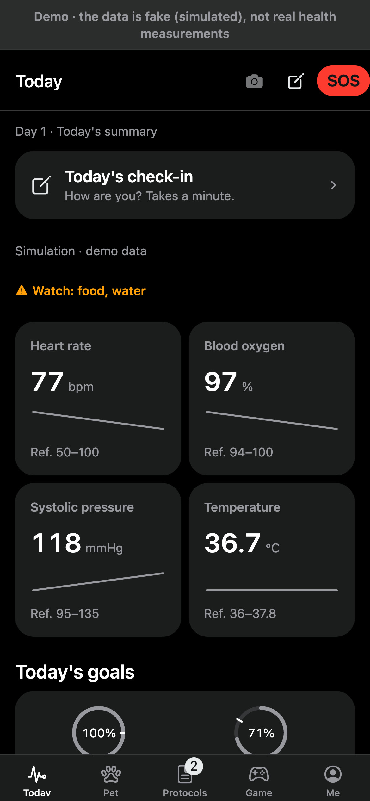
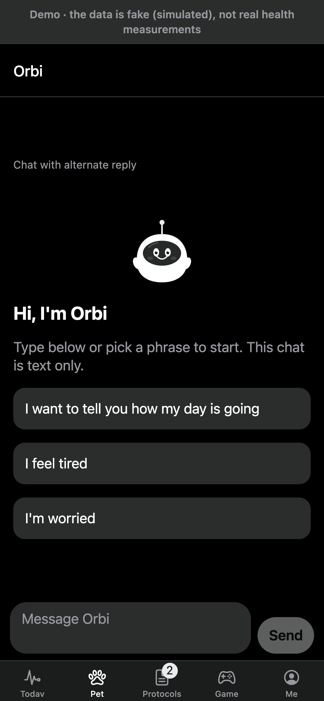
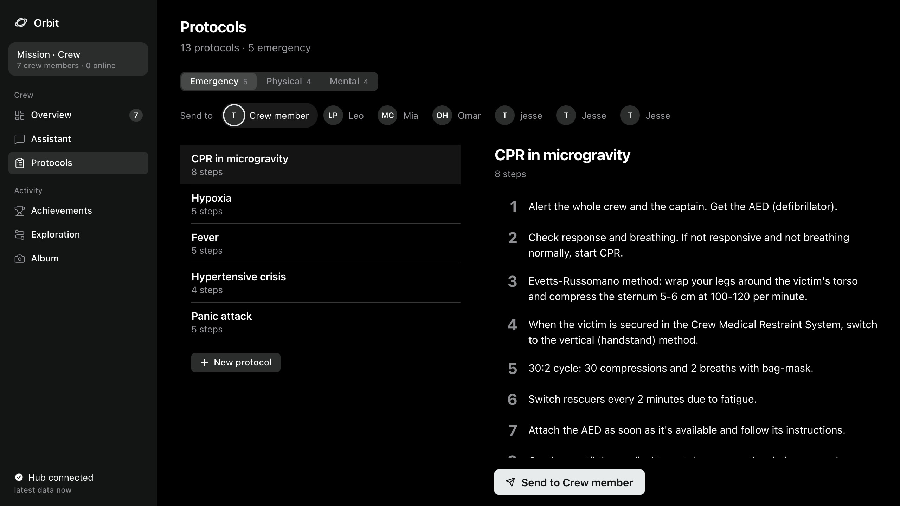

<p align="center"></p>

# ORBIT: Onboard Risk & Behavioral Insight Tracker

**NASA Space Apps Challenge 2026** · Challenge: *Create Health Monitoring Software for Astronauts on Space Missions* · CETYS Universidad, Mexicali

ORBIT is a wearable and software system that lets a crew watch its own physical and behavioral health **with no link to Earth**. Sensor garments stream vitals to each astronaut's wrist phone. The phone sends them over the habitat's local network to a mission computer, which runs the rules, raises emergencies, prescribes protocols and answers the commander through an AI assistant that runs entirely on board.

**▶ Demo video (30 s):** [docs/media/orbit-demo.mp4](docs/media/orbit-demo.mp4)

<p align="center"></p>

## High-level summary

ORBIT is a health monitor that a crew wears and runs on board, with no link to Earth. A smart vest, a wrist band and a head camera stream vitals to each astronaut's wrist phone. The phone turns those readings into a simple daily picture, and a companion pet named Orbi turns healthy habits into a game. A laptop on board collects the whole crew's data, raises emergencies and prescribes protocols, and it gives the commander an AI assistant that answers from NASA research. It addresses the challenge because the crew can catch a slow decline in heart health, sleep, exercise or mood themselves, before it becomes an emergency, even when Earth is minutes away.

## The problem

On Moon and Mars missions the crew faces radiation, isolation, confinement and altered gravity, while messages to Earth take minutes and the crew are not doctors. Health checks still depend mostly on ground teams and scattered data. NASA's Human Research Program names isolation and confinement and distance from Earth among the five hazards of spaceflight, and behavioral risk grows with mission length.

## A day with ORBIT

1. **Morning.** The astronaut puts on the vest and the wrist band. The chest light glows in the colour of their pet and the phone on the wrist shows *Today*: heart rate, blood oxygen, pressure and temperature against their normal range, plus a one-minute check-in on mood, stress and how the mission feels.
2. **Daily tests.** The app asks for a short physical test (5 jumps in place, counted by the vest's motion sensor) and a reaction game. Results go to the crew's achievements and leaderboard, so exercise becomes a shared game instead of a chore.
3. **During work.** The astronaut turns the phone sideways and gets ship mode: big readable vitals, the next task and a hold-to-SOS button. The vest light pulses with each heartbeat and turns red as heart rate rises, so crewmates can see stress at a glance.
4. **Feeling low.** Orbi, the companion pet, gets hungry, wants company and notices low mood, short sleep or high stress. The astronaut can talk to it; it runs on the phone, so it works offline, and its advice is drawn from NASA behavioral-health guidance.
5. **The commander's view.** On the mission laptop the commander sees every crew member live, who is out of range, who is near whom (Bluetooth proximity between phones, so isolation inside the crew is visible), and can send a protocol to anyone. Asking the assistant "Who is out of range right now?" returns an answer built from live data and NASA sources, with its reasoning shown as it thinks.
6. **Emergency.** If an astronaut holds SOS, or the hub sees critical vitals, every screen goes red with an alarm. The nearest crewmates are shown first, and the phone walks them through CPR adapted for microgravity, step by step.

## What we built

| Part | What it does | Where |
|---|---|---|
| **Wearables** | ESP32 chest vest (ECG at 250 Hz, heart rate, motion, skin temperature, LED light), wrist band (heart rate, motion), head band (camera that sends photos to the crew album) | [`firmware/`](firmware), 3D-printed enclosures designed for microgravity in [`hardware/`](hardware) |
| **Crew app** | Today, check-in, daily tests, Orbi the companion pet, achievements, leaderboard and explorations, crew album, ship mode, SOS with CPR guide | [`mobile/`](mobile) (Expo, iOS, Android and web) |
| **Mission hub** | Validates every reading, applies thresholds, detects emergencies, logs check-ins, tracks news from home and prescribes protocols per astronaut | [`hub/`](hub) (Node, runs on the commander's laptop) |
| **Commander dashboard** | Live crew board, per-astronaut detail and trends, proximity map, protocols, crew album, AI assistant with NASA sources | [`dashboard/`](dashboard) (Next.js) |
| **Shared contract** | One set of types, thresholds, messages and texts used by all parts, with self-checks | [`shared/`](shared) |

| Today | Companion pet | Pet chat |
|---|---|---|
|  |  |  |

**Ship mode.** Turn the wrist phone sideways and the app becomes a glanceable HUD: vitals in range, the next task, sensor links and a hold-to-SOS button.

<p align="center"></p>

**Commander dashboard.** The whole crew at a glance, and protocols the commander can send to any crew member.

<p align="center"></p>
<p align="center"></p>

<sub>Screenshots show the interface translated to English; the app currently ships in Spanish, the team's language. Vitals in screenshots come from the crew simulator.</sub>

### How it works

```
 Vest ESP32 ─ Bluetooth Classic (250 Hz ECG + IMU) ─┐
 Band ESP32 ─ BLE ──────────────────────────────────┼─► Crew phone (wrist) ── WebSocket on the habitat LAN ──► Mission hub
 Head ESP32 ─ BLE (camera) ─────────────────────────┘     on-device LLM pet                                  rules · emergencies · RAG · agent
                                                                                                                │
                                                                                     Commander dashboard ◄──────┤
                                                                                     local LLM (llama.cpp) ◄────┘
```

- **No internet needed.** Every model runs on board: a small Qwen3 model on the phone, a larger Qwen model on the mission laptop through llama.cpp.
- **Store and forward.** If the network drops, the phone queues up to 500 messages and sends them when it reconnects.
- **Emergencies both ways.** The astronaut can trigger SOS from the wrist, or the hub raises one from the vitals. The dashboard and every phone show it, and the phone walks the crew through CPR adapted for microgravity.
- **Behavioral health, not just vitals.** Daily check-ins, reaction tests, team interaction (proximity between crew phones) and news from home feed the risk picture, following NASA's Human Research Program behavioral risk.

More detail: [Technical paper (Spanish)](docs/ORBIT-paper.md) ([.docx](docs/ORBIT-paper.docx)) · [Architecture](docs/ARCHITECTURE.md) · [Conventions](docs/CONVENTIONS.md) · [Design brief](docs/product/DESIGN-BRIEF.md)

## From NASA research to features

Isolation and confinement and distance from Earth are two of the five hazards named by NASA's Human Research Program (HRP), and the chance of an adverse behavioral event grows with mission length. Each ORBIT feature answers one of these findings:

| NASA finding (paraphrased) | ORBIT feature | Source |
|---|---|---|
| Isolation and confinement weigh most on behavioral health on long missions; distance, microgravity and radiation add to it | The whole app is organized around the crew's mental state, not only vitals | HRP 5 Hazards; [`hub/kb/salud-conductual-nasa.md`](hub/kb/salud-conductual-nasa.md) |
| Positive mood drifts down with time in isolation and tracks operational performance | Daily check-in (mood, stress, mission outlook) tracked as a trend; a gradual dip is not an alarm by itself | APEX results (NTRS 20260002661); [`apex-resultados.md`](hub/kb/apex-resultados.md) |
| Small stressors accumulate into worst-case scenarios, so small trends are worth watching | Companion pet "Orbi" notices low mood, high stress or short sleep and gives short supportive cards | Picano and Holland 2024 (NTRS 20240000994) |
| Sleep loss degrades attention, reaction time and emotional regulation | Sleep feeds the pet's guidance; the reaction game and protocols give a quick performance check | [`sueno-en-mision.md`](hub/kb/sueno-en-mision.md) |
| Crew friction tends to grow over a mission | Bluetooth proximity between crew phones shows who is near whom, so isolation inside the crew is visible and the nearest crewmates answer an SOS first | NASA team-risk evidence report 2022; [`trabajo-en-equipo-nasa.md`](hub/kb/trabajo-en-equipo-nasa.md) |
| Bad news from home hits hard, and grief at a distance has its own needs | "News from home" watch: the commander logs it, the crew member stays on watch for 14 days and the pet switches to supportive, honest cards | [`duelo-a-distancia.md`](hub/kb/duelo-a-distancia.md); WHO psychological first aid |
| Behavioral risk is low on 6-month missions but rises with duration and distance | An on-board assistant for the commander that works with no link to Earth; SOS and CPR flows for acute events | HRP evidence report 2025; [`riesgo-conductual-nasa.md`](hub/kb/riesgo-conductual-nasa.md) |

**How:** the commander's on-board assistant retrieves these documents (retrieval over [`hub/kb/`](hub/kb) through its `search_knowledge` tool) and cites each one's NASA source. The phone's small model has no retrieval, so the same evidence is distilled into the pet's tips ([`shared/src/petTips.ts`](shared/src/petTips.ts)).

## NASA data and resources

The knowledge base ([`hub/kb/`](hub/kb)) is built from these sources (paraphrased, each file cites its source):

- NASA Human Research Program, *Human Research Program hazards* (isolation and confinement, sleep, distance from Earth): https://www.nasa.gov/hrp/hazards/
- NASA HRP Evidence Report, *Risk of Adverse Cognitive or Behavioral Conditions and Psychiatric Disorders* (2025): https://ntrs.nasa.gov/citations/20250001454
- NASA OCHMO-TB-016, *Behavioral Health and Performance*, Rev B (2023): https://www.nasa.gov/wp-content/uploads/2023/12/ochmo-tb-016-behavioral-health.pdf
- NASA HRP Evidence Report, *Risk of Performance and Behavioral Health Decrements Due to Inadequate Cooperation, Coordination, Communication, and Psychosocial Adaptation within a Team* (2022): https://ntrs.nasa.gov/citations/20220007465
- Picano and Holland, *Behavioral Health and Performance*, NASA CLDP MedOps Workshop (2024): https://ntrs.nasa.gov/citations/20240000994
- Bell et al., *Summary Results from the APEX Standardized Suite*, NASA HRP Investigators' Workshop (2026): https://ntrs.nasa.gov/citations/20260002661 and https://ntrs.nasa.gov/citations/20250011721

Space agency partner and other sources:

- ESA / DGLRM guideline for CPR in microgravity (2020): https://pmc.ncbi.nlm.nih.gov/articles/PMC7607644/
- WHO, *Psychological first aid: Guide for field workers* (2011): https://www.who.int/publications/i/item/9789241548205

## Benefits and goals

- **Autonomy.** The crew watches its own health on board; Earth becomes a backup, not the bottleneck.
- **Early warning.** Trends in vitals, sleep, mood and team contact show a decline days before it becomes an emergency.
- **Adherence.** The pet, achievements and leaderboard make check-ins and exercise something the crew wants to do.
- **Faster response.** SOS reaches every screen at once, and CPR steps are on the wrist when seconds count.
- **On Earth too.** The same kit fits isolated teams such as Antarctic stations, submarines, offshore rigs and remote clinics.

Next we want to align thresholds with NASA-STD-3001, move the body network to ESP-NOW with LoRa repeaters across the habitat, add a radiation dose sensor, and test ORBIT in a space analog habitat.

## Tools

TypeScript across the stack · React Native with Expo (iOS, Android, web) · Next.js and Tailwind (dashboard) · Node with WebSockets (hub) · PostgreSQL with pgvector, optional Supabase · llama.cpp with Qwen models (on-board AI), llama.rn on the phone · ESP32 and XIAO ESP32-C3 with Arduino (ECG module, MPU6050, GY-906, WS2812 LEDs) · SolidWorks enclosures (STL and STEP), 3D printed in PLA.

## Run it

```bash
npm run db         # local pgvector (Docker); optional, the hub falls back to memory
npm run hub        # mission hub on :8790
npm run sim        # 4 simulated crew members (add -- --emergency c2)
npm run dashboard  # commander dashboard
npm run mobile     # crew app (Expo)
npm run check      # contract self-checks
```

The assistant needs a llama.cpp server on `:8080` (`LLM_URL`). Firmware builds with `arduino-cli` for `esp32:esp32:esp32` (vest) and the XIAO ESP32-C3 (head band).

## Status and limits

- **Working:** vest streaming 250 Hz ECG, heart rate and IMU to the phone over Bluetooth, chest LED light painted in the astronaut's pet colour that pulses with each heartbeat and turns red as heart rate rises, crew app on iOS, Android and web, hub, dashboard, on-board assistant with NASA sources, SOS flow, daily protocols.
- **Simulated in the demo:** blood pressure, temperature (when the sensor is missing), water and sleep. These are clearly generated values for demonstration, not readings.
- **Enclosures** are PLA prototypes. A flight version would use flame-retardant, low off-gassing materials such as ULTEM 9085 or PEEK ([details](hardware/README.md#design-for-spaceflight)).
- **Not measured by wearables:** glucose, EEG, bone and muscle loss. The hub prescribes a check on the ship's dedicated equipment instead.
- **Thresholds** are generic adult clinical ranges for now (`shared/src/index.ts`); the next step is to align them with NASA-STD-3001.
- **Planned:** ESP-NOW body network with LoRa repeaters across the habitat, a radiation dose sensor, and a 3D crew status view.

## Use of AI

- **In the product:** a small Qwen3 model runs on the phone for the companion pet. A Qwen model served by llama.cpp powers the commander's assistant, which uses retrieval over the NASA knowledge base and tools to read crew data.
- **In development:** the team used an AI coding assistant (Claude Code) to help write and review code across the repository. The idea, the hardware and all design decisions are the team's own. No AI-generated images or NASA branding are used.

## Team

Jorge Humberto Ibarra Flores · Alejandro Pineda Aguirre · Francisco Javier Castillo Osobampo · Erick Blanco Nakashima · Jesse Banda Chaidez

CETYS Universidad, Mexicali, Baja California, Mexico.

## License

[MIT](LICENSE)
