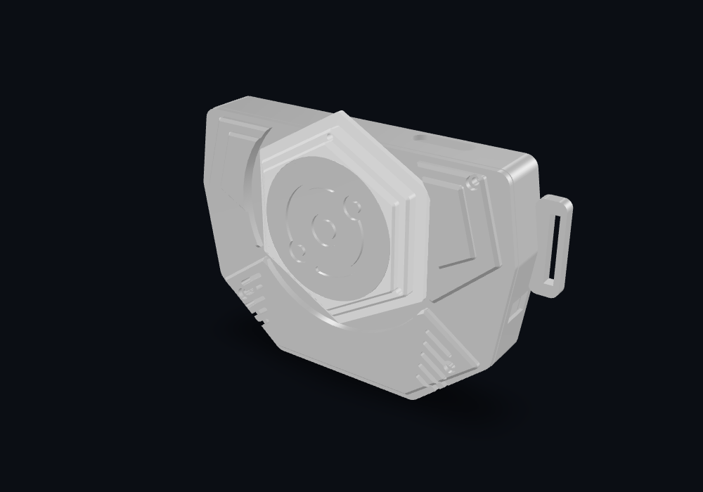
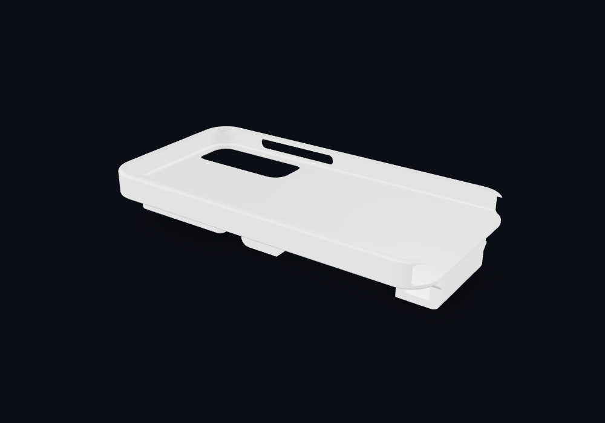
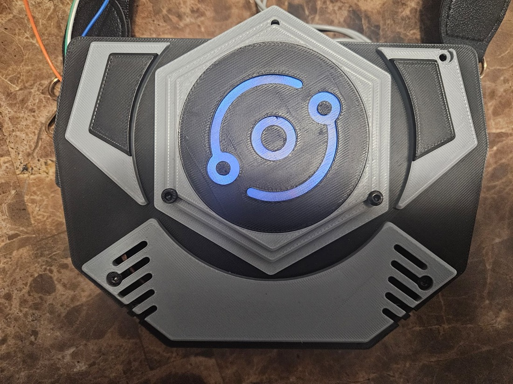
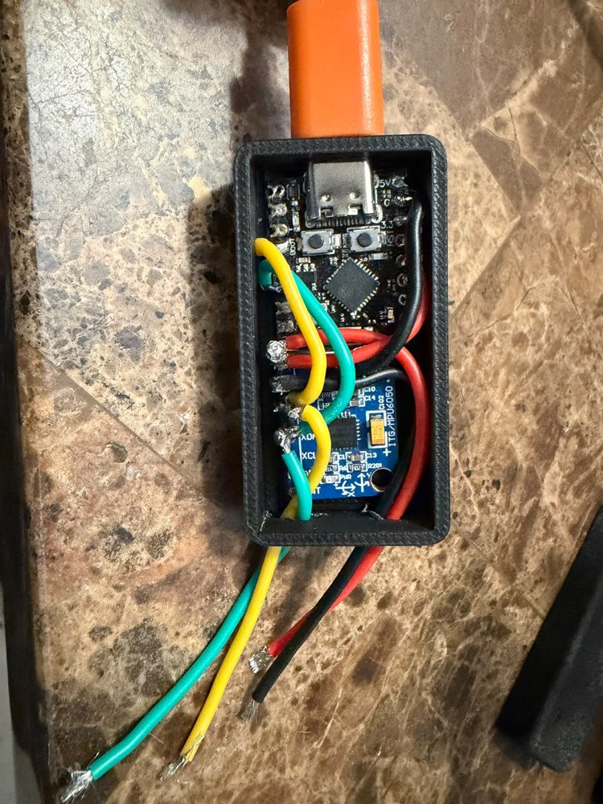
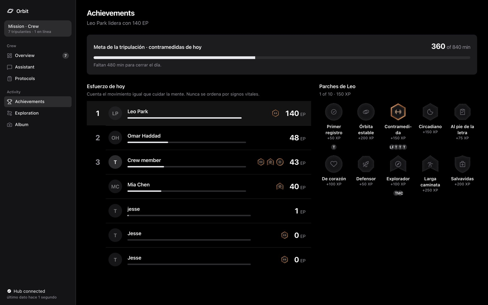
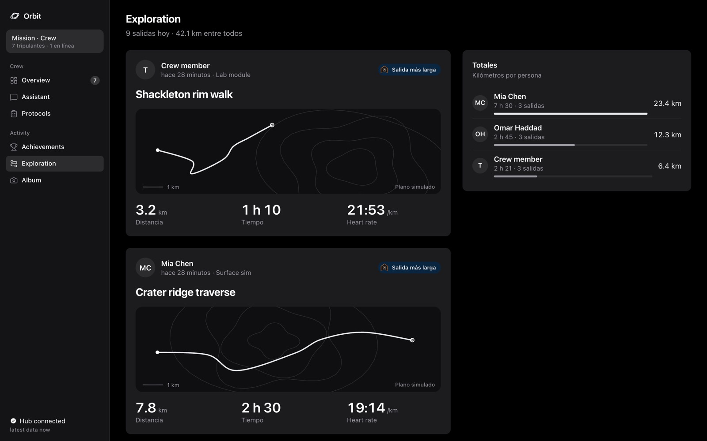
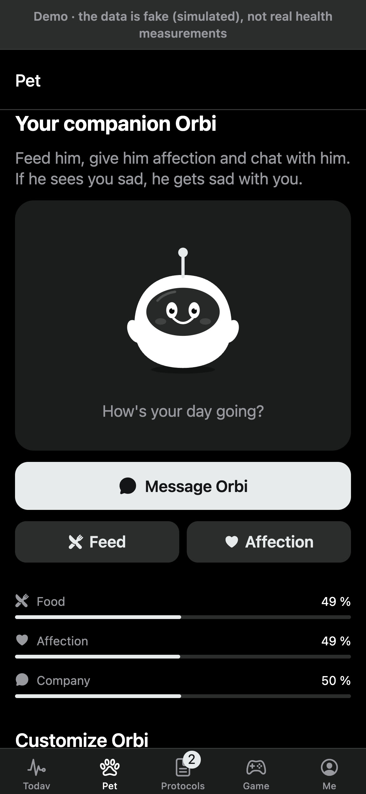
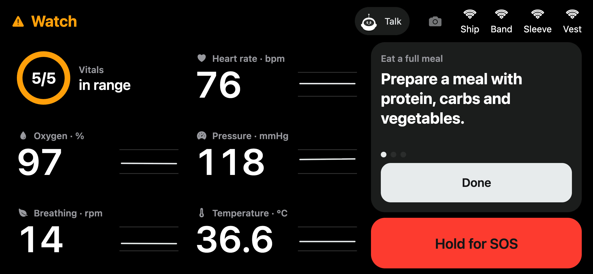
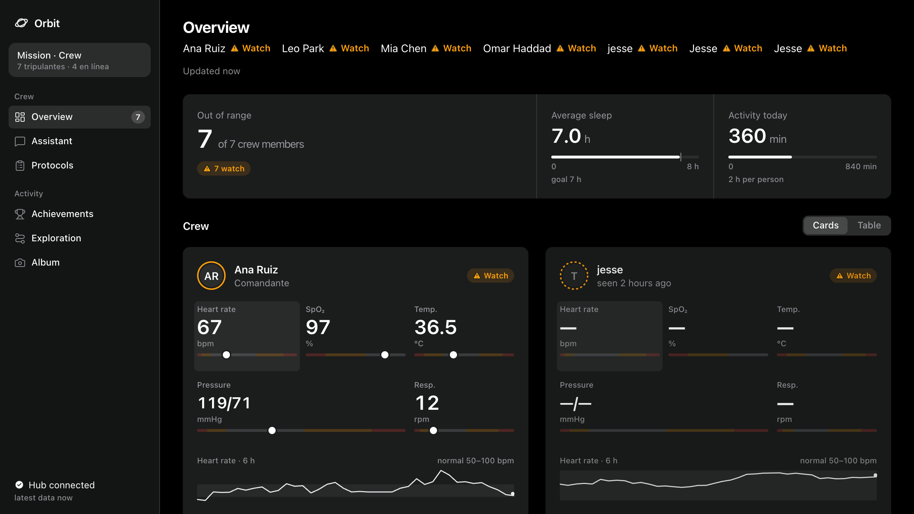

<p align="center"></p>

# ORBIT: Onboard Risk & Behavioral Insight Tracker

<p align="center"><b>🏆 Local winner · NASA Space Apps Challenge 2026, Mexicali</b></p>

**NASA Space Apps Challenge 2026** · Challenge: *Create Health Monitoring Software for Astronauts on Space Missions* · CETYS Universidad, Mexicali

ORBIT is a wearable and software system that lets a crew watch its own physical and behavioral health **with no link to Earth**. Sensor garments stream vitals to each astronaut's wrist phone. The phone sends them over the habitat's local network to a mission computer, which runs the rules, raises emergencies, prescribes protocols and answers the commander through an AI assistant that runs entirely on board.

**▶ Demo video (30 s):** [docs/media/orbit-demo.mp4](docs/media/orbit-demo.mp4)

**Quick links:** [Demo video](docs/media/orbit-demo.mp4) · [Technical paper (ES, .md)](docs/ORBIT-paper.md) · [Paper (.docx)](docs/ORBIT-paper.docx) · [Features](#features) · [On-board AI](#on-board-ai-a-92-gb-model-on-a-24-gb-laptop) · [NASA data](#nasa-data-and-resources) · [Hardware and CAD](#hardware-and-cad) · [Firmware](firmware) · [Run it](#run-it) · [Status and limits](#status-and-limits)

<p align="center"></p>

## High-level summary

ORBIT is a health monitor that a crew wears and runs on board, with no link to Earth. A smart vest, a wrist band and a head camera stream vitals to each astronaut's wrist phone. The phone turns those readings into a simple daily picture, and a companion pet named Orbi turns healthy habits into a game. A laptop on board collects the whole crew's data, raises emergencies and prescribes protocols, and it gives the commander an AI assistant that answers from NASA research. It addresses the challenge because the crew can catch a slow decline in heart health, sleep, exercise or mood themselves, before it becomes an emergency, even when Earth is minutes away.

## The problem

On Moon and Mars missions the crew faces radiation, isolation, confinement and altered gravity, while messages to Earth take minutes and the crew are not doctors. Health checks still depend mostly on ground teams and scattered data. NASA's Human Research Program names isolation and confinement and distance from Earth among the five hazards of spaceflight, and behavioral risk grows with mission length.

## A day with ORBIT

1. **Morning.** The astronaut puts on the vest and the wrist band. The chest light glows in the colour of their pet and the phone on the wrist shows *Today*: heart rate, blood oxygen, pressure and temperature against their normal range, plus a one-minute check-in on mood, stress and how the mission feels.
2. **Daily tests.** The app asks for a short physical test (5 jumps in place, counted by the vest's motion sensor) and a reaction game. Results go to the crew's achievements and leaderboard, so exercise becomes a shared game instead of a chore.
3. **During work.** The astronaut turns the phone sideways and gets ship mode: big readable vitals, the next task and a hold-to-SOS button. The vest light pulses with each heartbeat and turns red as heart rate rises, so crewmates can see stress at a glance.
4. **Feeling low.** Orbi, the companion pet, gets hungry, wants company and notices low mood, short sleep or high stress. The astronaut can talk to it; it runs on the phone, so it works offline, and its advice is drawn from NASA behavioral-health guidance.
5. **The commander's view.** On the mission laptop the commander sees every crew member live, who is out of range, who is near whom (Bluetooth proximity between phones, so isolation inside the crew is visible), and can send a protocol to anyone. Asking the assistant "Who is out of range right now?" returns an answer built from live data and NASA sources, with its reasoning shown as it thinks.
6. **Emergency.** If an astronaut holds SOS, or the hub sees critical vitals, every screen goes red with an alarm. The nearest crewmates are shown first, and the phone walks them through CPR adapted for microgravity, step by step.

## What we built

| Part | What it does | Where |
|---|---|---|
| **Wearables** | ESP32 chest vest (ECG at 250 Hz, heart rate, motion, skin temperature, LED light), wrist band (heart rate, motion), head band (ESP32 camera on the forehead that takes photos hands-free while the phone is busy in ship mode, worn in the team photo) | [`firmware/`](firmware), 3D-printed enclosures designed for microgravity in [`hardware/`](hardware) |
| **Crew app** | Today, check-in, daily tests, Orbi the companion pet, achievements, leaderboard and explorations, crew album, ship mode, SOS with CPR guide | [`mobile/`](mobile) (Expo, iOS, Android and web) |
| **Mission hub** | Validates every reading, applies thresholds, detects emergencies, logs check-ins, tracks news from home and prescribes protocols per astronaut | [`hub/`](hub) (Node, runs on the commander's laptop) |
| **Commander dashboard** | Live crew board, per-astronaut detail and trends, proximity map, protocols, crew album, AI assistant with NASA sources | [`dashboard/`](dashboard) (Next.js) |
| **Shared contract** | One set of types, thresholds, messages and texts used by all parts, with self-checks | [`shared/`](shared) |

## Hardware and CAD

We designed and 3D printed our own enclosures in SolidWorks (by Erick Blanco Nakashima). Every part is in [`hardware/`](hardware) as printable STL and editable STEP, plus a full assembly in `.glb` that GitHub opens as an interactive 3D view.

<p align="center"> </p>

<p align="center"></p>

<p align="center"></p>

| Device | Inside | CAD |
|---|---|---|
| **Chest vest** | ESP32, ECG front end (250 Hz), MPU6050 motion sensor, GY-906 skin temperature, WS2812 LED ring behind a translucent logo disc | [3D view](hardware/vest/PecheraAssem.glb) · [STL](hardware/vest/stl) · [STEP](hardware/vest/step) |
| **Wrist band** | XIAO ESP32-C3 with MPU motion sensor in its own box, rail sled and phone mount | [3D view](hardware/wrist/MunecaAssem.glb) · [STL](hardware/wrist/stl) |
| **Head band** | ESP32 with a camera on the forehead: hands-free photos while the phone is in ship mode, sent over Bluetooth to the crew album | firmware in [`firmware/`](firmware) |
| **Wrist phone** | Android phone that runs the crew app and a local AI model | mount: `soporte_S23plus_v3_respaldo_plano.STL` |

**Why a phone on the wrist and not a smartwatch:** a watch cannot run a language model on board. A phone has the memory to run the companion's AI fully offline, a screen big enough for ship mode, Bluetooth to every sensor and Wi-Fi to the mission laptop. Design notes for spaceflight materials are in [`hardware/README.md`](hardware/README.md#design-for-spaceflight).

## Features

ORBIT treats health as physical and psychological at once. NASA's research says isolation, monotony and distance wear a crew down slowly, so most features are built around three ideas from psychology: **feeling seen** (someone notices how you are), **belonging** (you are part of a crew, not alone in a can), and **motivation through progress** (small, visible wins that make healthy habits stick).

### 1. Know how you are: Today, check-in and insights

- **Today screen.** Heart rate, blood oxygen, blood pressure and temperature, each against its normal range, plus daily goals for activity, food and water with a mark for where you should be by now.
- **Daily check-in (one minute).** Mood (an interactive shape that changes with your answer), stress (calm to very high), mission outlook (pessimistic to optimistic), plus free text for discomfort and a note. NASA's isolation studies use the same kind of short daily self-report to catch mood drift early.
- **Insights.** After 5 days the app compares your last 3 days with the days before and tells you in plain words when something changed, with a 7-day chart: sleep down an hour or more, mood falling, talking to the crew less than half as much, gaming much more while mood drops, or patterns such as "your mood follows your sleep" and "your stress drops on active days".

### 2. Motivation through progress: achievements, levels and leaderboard

Long missions are monotonous, and exercise is a countermeasure astronauts must keep up for months. ORBIT makes progress visible:

- **10 achievements with XP**, for example *First log* (first check-in), *Stable orbit* (7-day check-in streak), *Countermeasure* (120 minutes of exercise in a day), *Circadian* (3 nights of 7 hours or more), *Long walk* (10 km in total) and *Lifesaver* (a CPR drill).
- **Levels.** Every 500 XP is a new level, shown as a ring on your profile that fills as you go.
- **Crew leaderboard.** Ranks the day's *effort points*: minutes of activity, checking in, time spent with the pet and distance explored, capped so nobody wins by overtraining. It rewards taking care of yourself, not raw performance.

### 3. Explorations: a Strava for the crew

- Log each outing or training session (an EVA walk, a treadmill run, a habitat circuit) with a title, place, stopwatch time and distance. The app works out the pace.
- Each outing appears in the crew feed on the dashboard with its route card, pace and a **personal record** badge when it is someone's longest, plus weekly totals and a crew ranking by kilometres.
- Like Strava, the point is social: seeing crewmates' outings and cheering for records builds the shared routine that NASA's team research links to cohesion.
- *Prototype note:* distance is typed in and the route drawing is illustrative; GPS-free indoor tracking from the vest's motion sensor is the next step.

<p align="center"> </p>

### 4. Never alone: Orbi, the companion pet

- Every astronaut has **Orbi**, a small creature on the wrist. You pick one of 5 shapes and 6 suit colours, and **the vest's chest light glows in that same colour**, so your pet is literally on you.
- Orbi has three needs: **food**, **affection** and **company**. They empty over hours (8, 6 and 12) and you refill them by feeding, petting and talking to it. Caring for something small every day is a gentle routine with a reason behind it.
- Orbi reads your state. It gets **sad** if your last check-in showed low mood or high stress and you have not talked since, if a vital is critical, or if a need runs out; it gets **tired** when you slept under 6 hours. Its face is a mirror that nudges you to check in.
- **Talk to Orbi.** A chat with an AI that runs on the phone, so it works with no network. Suggested openers ("I want to tell you how my day is going", "I feel tired") lower the barrier to talking. If a message sounds like a crisis, Orbi always answers with a fixed line that points to a human crewmate.
- **Guided session (4 minutes).** How do you feel, two short questions, three breathing cycles, close.

### 5. Belonging: proximity, team contact and news from home

- **Who is near whom.** Every phone listens for the other crew phones over Bluetooth and turns signal strength into approximate distance. The commander sees a live map of the crew.
- **Isolation alerts.** The hub keeps minutes of contact per person and channel (voice, text, in person) and compares the last 24 hours with a 7-day baseline. It flags **withdrawal** (less than half the usual contact), a **spike** (2.5 times the usual), and a **dropped peer** (someone you talked to on most days but not today). Withdrawal or a dropped peer sends a *Talk to a crewmate* protocol.
- **News from home.** When the commander learns of hard news for a crew member (a loss in the family, for example), they log it once. That person stays on *watch* for 14 days, receives a grief support protocol, and the commander is reminded too. Bad news far from home is one of the situations NASA's behavioral guidance singles out.
- **Crew album.** The head-band camera (an ESP32 with a camera, worn on the forehead) takes photos hands-free, so the astronaut can capture evidence or a moment while the wrist phone is busy sideways in ship mode. Photos go straight into a shared album on every phone and on the dashboard. Shared moments are part of feeling like a crew.

### 6. Daily care: protocols and tests

- **Protocol library:** emergency (CPR in microgravity, hypoxia, fever, hypertensive crisis, panic attack), physical (jumping exercise, hydration, sleep hygiene, eat a full meal) and mental (box breathing, talk to a crewmate, grief support, 5-minute journal). Each one is a short list of steps on the phone.
- **Who sends them.** The hub's rules (for example low activity late in the day, under 6 hours of sleep, low water, low mood or high stress, hard news, isolation alerts), the commander by hand, or the AI assistant. Each protocol is sent at most once every 30 minutes, so nobody gets nagged.
- **Daily tests.** A physical test of **5 jumps in place**, counted by the vest's motion sensor (heart rate is ignored during the test because motion distorts it), and a **5-try reaction test** for alertness. A **CPR drill** keeps rescue skills fresh.
- **Orbit Defender.** A short arcade game (waves of enemies, coins, shields and extra lives) for a break, which also counts toward an achievement and toward the insights on gaming versus mood.

### 7. Emergencies

- **Automatic triggers** from the vitals: heart rate under 30 or over 180 (or under 40 with low oxygen), blood oxygen under 88%, temperature of 39 °C or more, or blood pressure of 180/120 or more.
- **Manual SOS:** hold the red button on the wrist.
- **The nearest two crewmates are called first**, using the same Bluetooth distance; if nobody is in range, everyone online is alerted.
- The person in trouble sees a calm message; rescuers see that they are first or second responder, and for cardiac arrest the phone runs a **CPR guide for microgravity** (110 compressions per minute, 30:2, switch rescuers every 2 minutes). The dashboard shows a red banner, a timer, responders with their distance and an alarm sound; resolving takes a deliberate two-step confirmation.

### 8. The commander's dashboard

- Crew overview with status (normal, watch, critical), averages for sleep and activity, and live cards with each person's vitals.
- Detail per astronaut: every metric against its range and a 7-day average, heart rate charts over 6 hours, 24 hours or 14 days, check-ins, contact history and news from home.
- Proximity map, explorations feed, leaderboard, protocols (send one or write a new one), crew album, and the AI assistant described below.

### 9. Ship mode and the chest light

- **Ship mode.** Turn the wrist phone sideways and it becomes a glanceable HUD: big vitals, the next task, sensor links and the SOS button, readable while working.
- **Chest light.** The vest's LED ring shows the pet's colour, pulses with each heartbeat and blends to red as heart rate climbs from 100 to 130 bpm, so crewmates can see stress without asking.

| Today | Companion pet | Pet chat |
|---|---|---|
|  |  |  |

**Ship mode.** Turn the wrist phone sideways and the app becomes a glanceable HUD: vitals in range, the next task, sensor links and a hold-to-SOS button.

<p align="center"></p>

**Commander dashboard.** The whole crew at a glance, and protocols the commander can send to any crew member.

<p align="center"></p>
<p align="center"></p>

<sub>Screenshots show the interface translated to English; the app currently ships in Spanish, the team's language. Vitals in screenshots come from the crew simulator.</sub>

### How it works

```
 Vest ESP32 ─ Bluetooth Classic (250 Hz ECG + IMU) ─┐
 Band ESP32 ─ BLE ──────────────────────────────────┼─► Crew phone (wrist) ── WebSocket on the habitat LAN ──► Mission hub
 Head ESP32 ─ BLE (camera) ─────────────────────────┘     on-device LLM pet                                  rules · emergencies · RAG · agent
                                                                                                                │
                                                                                     Commander dashboard ◄──────┤
                                                                                     local LLM (llama.cpp) ◄────┘
```

- **No internet needed.** Every model runs on board: a small model on the phone and a 92 GB model on the mission laptop (see below).
- **Store and forward.** If the network drops, the phone queues up to 500 messages and sends them when it reconnects.
- **Emergencies both ways.** The astronaut can trigger SOS from the wrist, or the hub raises one from the vitals. The dashboard and every phone show it, and the phone walks the crew through CPR adapted for microgravity.
- **Behavioral health, not just vitals.** Daily check-ins, reaction tests, team interaction (proximity between crew phones) and news from home feed the risk picture, following NASA's Human Research Program behavioral risk.

### On-board AI: a 92 GB model on a 24 GB laptop

A crew far from Earth cannot call a cloud model, and medical data should never leave the ship. So the commander's assistant runs a large model entirely on the mission laptop (a MacBook Pro M5 Pro with 24 GB of RAM).

**The model.** Qwen3.8 Flash Next, a mixture-of-experts (MoE) model, quantized to IQ4_XS: about 92 GB on disk, roughly four times the laptop's memory. Each token only activates a few experts, so the whole model never needs to be in RAM at once. The model was used **only locally**: open weights downloaded once and run on our own laptop, with no API, no account and no data sent anywhere.

**The llama.cpp fork.** We serve it with a fork of llama.cpp ([npanj/llama.cpp](https://github.com/npanj/llama.cpp)) that adds expert streaming (`--moe-stream`):

| Piece | Setting | Why |
|---|---|---|
| Expert streaming | `--moe-stream --moe-stream-direct` | Experts are read from the SSD on demand instead of loading the full 92 GB |
| Expert cache | `--moe-stream-cache 9` (9 GB), 8 I/O threads, look-ahead prefetch | Hot experts stay in RAM; the next ones are fetched while the current token computes |
| KV cache | `-ctk q8_0 -ctv q8_0`, flash attention, 16k context | Long conversations fit next to everything else |
| GPU | `-ngl 99` (Apple Metal) | All dense layers on the GPU |
| Sleep | `--sleep-idle-seconds 300` | The model unloads after 5 minutes idle (about 12 to 15 GB active, near zero asleep) and wakes on the next question |

The launch script is [`hub/scripts/llm.sh`](hub/scripts/llm.sh). It serves an OpenAI-compatible API on `localhost:8080` with no network access and no computer-control tools. Generation runs at about 9 tokens per second, so the hub streams the model's thinking to the dashboard as it arrives instead of leaving the commander staring at a spinner.

**Tools.** The assistant ([`hub/src/services/agent.ts`](hub/src/services/agent.ts)) is a tool-calling agent. Each question runs up to 4 rounds: the model thinks, calls tools, reads the results and answers; the last round has no tools, so it must answer with what it gathered. Its tools:

| Tool | What it does |
|---|---|
| `get_crew_overview` | Live vitals, status and last contact for every crew member |
| `get_member_history` | One astronaut's trends over time |
| `get_comms` | Who has been near whom (team contact and isolation) |
| `search_knowledge` | Retrieval over the NASA knowledge base (below) |
| `list_protocols` | The protocol library |
| `trigger_protocol` | Sends a protocol to an astronaut's phone, with a reason |
| `create_protocol` | Writes a new protocol (mental, physical or emergency) and sends it |

Every tool call and its result are shown under the answer, so the commander can check what the model actually looked at.

**Retrieval (RAG).** The NASA documents in [`hub/kb/`](hub/kb) are split into ~800-character chunks with overlap ([`hub/src/services/rag.ts`](hub/src/services/rag.ts)), embedded with `multilingual-e5-small` (about 120 MB, runs in Node through transformers.js) and stored in PostgreSQL with pgvector. A question is embedded the same way and the closest chunks come back with their source, which the model cites. If the database is down, the hub keeps the same index in memory and ranks by cosine similarity, so retrieval still works. Run `npm run ingest` in `hub/` after adding a document.

**On the phone.** The companion pet uses a separate 1-bit Bonsai-4B model (about 570 MB) through llama.rn, so it works with no network at all and is released from memory after 2 minutes idle.

More detail: [Technical paper (Spanish)](docs/ORBIT-paper.md) ([.docx](docs/ORBIT-paper.docx)) · [Architecture](docs/ARCHITECTURE.md) · [Conventions](docs/CONVENTIONS.md) · [Design brief](docs/product/DESIGN-BRIEF.md)

## From NASA research to features

Isolation and confinement and distance from Earth are two of the five hazards named by NASA's Human Research Program (HRP), and the chance of an adverse behavioral event grows with mission length. Each ORBIT feature answers one of these findings:

| NASA finding (paraphrased) | ORBIT feature | Source |
|---|---|---|
| Isolation and confinement weigh most on behavioral health on long missions; distance, microgravity and radiation add to it | The whole app is organized around the crew's mental state, not only vitals | HRP 5 Hazards; [`hub/kb/salud-conductual-nasa.md`](hub/kb/salud-conductual-nasa.md) |
| Positive mood drifts down with time in isolation and tracks operational performance | Daily check-in (mood, stress, mission outlook) tracked as a trend; a gradual dip is not an alarm by itself | APEX results (NTRS 20260002661); [`apex-resultados.md`](hub/kb/apex-resultados.md) |
| Small stressors accumulate into worst-case scenarios, so small trends are worth watching | Companion pet "Orbi" notices low mood, high stress or short sleep and gives short supportive cards | Picano and Holland 2024 (NTRS 20240000994) |
| Sleep loss degrades attention, reaction time and emotional regulation | Sleep feeds the pet's guidance; the reaction game and protocols give a quick performance check | [`sueno-en-mision.md`](hub/kb/sueno-en-mision.md) |
| Crew friction tends to grow over a mission | Bluetooth proximity between crew phones shows who is near whom, so isolation inside the crew is visible and the nearest crewmates answer an SOS first | NASA team-risk evidence report 2022; [`trabajo-en-equipo-nasa.md`](hub/kb/trabajo-en-equipo-nasa.md) |
| Bad news from home hits hard, and grief at a distance has its own needs | "News from home" watch: the commander logs it, the crew member stays on watch for 14 days and the pet switches to supportive, honest cards | [`duelo-a-distancia.md`](hub/kb/duelo-a-distancia.md); WHO psychological first aid |
| Behavioral risk is low on 6-month missions but rises with duration and distance | An on-board assistant for the commander that works with no link to Earth; SOS and CPR flows for acute events | HRP evidence report 2025; [`riesgo-conductual-nasa.md`](hub/kb/riesgo-conductual-nasa.md) |

**How:** the commander's on-board assistant retrieves these documents (retrieval over [`hub/kb/`](hub/kb) through its `search_knowledge` tool) and cites each one's NASA source. The phone's small model has no retrieval, so the same evidence is distilled into the pet's tips ([`shared/src/petTips.ts`](shared/src/petTips.ts)).

## NASA data and resources

The knowledge base ([`hub/kb/`](hub/kb)) is built from these sources (paraphrased, each file cites its source):

- NASA Human Research Program, *Human Research Program hazards* (isolation and confinement, sleep, distance from Earth): https://www.nasa.gov/hrp/hazards/
- NASA HRP Evidence Report, *Risk of Adverse Cognitive or Behavioral Conditions and Psychiatric Disorders* (2025): https://ntrs.nasa.gov/citations/20250001454
- NASA OCHMO-TB-016, *Behavioral Health and Performance*, Rev B (2023): https://www.nasa.gov/wp-content/uploads/2023/12/ochmo-tb-016-behavioral-health.pdf
- NASA HRP Evidence Report, *Risk of Performance and Behavioral Health Decrements Due to Inadequate Cooperation, Coordination, Communication, and Psychosocial Adaptation within a Team* (2022): https://ntrs.nasa.gov/citations/20220007465
- Picano and Holland, *Behavioral Health and Performance*, NASA CLDP MedOps Workshop (2024): https://ntrs.nasa.gov/citations/20240000994
- Bell et al., *Summary Results from the APEX Standardized Suite*, NASA HRP Investigators' Workshop (2026): https://ntrs.nasa.gov/citations/20260002661 and https://ntrs.nasa.gov/citations/20250011721

Space agency partner and other sources:

- ESA / DGLRM guideline for CPR in microgravity (2020): https://pmc.ncbi.nlm.nih.gov/articles/PMC7607644/
- WHO, *Psychological first aid: Guide for field workers* (2011): https://www.who.int/publications/i/item/9789241548205

## Benefits and goals

- **Autonomy.** The crew watches its own health on board; Earth becomes a backup, not the bottleneck.
- **Early warning.** Trends in vitals, sleep, mood and team contact show a decline days before it becomes an emergency.
- **Adherence.** The pet, achievements and leaderboard make check-ins and exercise something the crew wants to do.
- **Faster response.** SOS reaches every screen at once, and CPR steps are on the wrist when seconds count.
- **On Earth too.** The same kit fits isolated teams such as Antarctic stations, submarines, offshore rigs and remote clinics.

Next we want to align thresholds with NASA-STD-3001, move the body network to ESP-NOW with LoRa repeaters across the habitat, add a radiation dose sensor, and test ORBIT in a space analog habitat.

## Beyond space

Nothing in ORBIT is tied to our vest. The hub accepts vitals from any source, so data exported from an Apple Watch, a Fitbit or any other wearable could feed the same rules, protocols and assistant. And because the assistant answers from NASA's research on isolation, confinement and behavioral health, which applies to anyone who lives far from help, the same system works wherever people are isolated and offline:

- Antarctic and Arctic research stations, submarines, offshore platforms and remote mines
- Expeditions, ships at sea and military deployments
- Rural clinics and communities without reliable internet
- Older adults who live alone, and their families or caregivers
- Remote and night-shift workers

Everything runs on a phone and a laptop with no internet, so it could be deployed in any of these places tomorrow.

## Tools

TypeScript across the stack · React Native with Expo (iOS, Android, web) · Next.js and Tailwind (dashboard) · Node with WebSockets (hub) · PostgreSQL with pgvector, optional Supabase · llama.cpp fork with MoE expert streaming and Qwen3.8 Flash Next (on-board AI), transformers.js embeddings, llama.rn with Bonsai-4B on the phone · ESP32 and XIAO ESP32-C3 with Arduino (ECG module, MPU6050, GY-906, WS2812 LEDs) · SolidWorks enclosures (STL and STEP), 3D printed in PLA.

## Run it

### Requirements

- Node.js 20 or newer and npm (the repo is an npm workspace: `shared`, `hub`, `dashboard`, `mobile`)
- Docker, optional, for the local pgvector database (`docker-compose.yml`); without it the hub keeps the knowledge index in memory
- For the on-board assistant: the [npanj/llama.cpp](https://github.com/npanj/llama.cpp) fork built with Metal, an open-weight GGUF model, and `LLAMA_SERVER` / `ORBIT_MODEL` set as in [`.env.example`](.env.example)
- For the crew app on a phone: Expo (Android or iOS); the web build runs in any browser
- For the wearables: `arduino-cli` with the ESP32 core

Copy `.env.example` to `.env`, then `npm install` at the root.

```bash
npm run db         # local pgvector (Docker); optional, the hub falls back to memory
npm run hub        # mission hub on :8790
npm run sim        # 4 simulated crew members (add -- --emergency c2)
npm run dashboard  # commander dashboard
npm run mobile     # crew app (Expo)
npm run check      # contract self-checks
```

The assistant needs a llama.cpp server on `:8080` (`LLM_URL`). Firmware builds with `arduino-cli` for `esp32:esp32:esp32` (vest) and the XIAO ESP32-C3 (wrist band and head band).

## Repository structure

```
orbit-spaceapps/
├── shared/      types, thresholds, messages and texts used by every part, with self-checks
├── hub/         mission hub (Node): rules, emergencies, protocols, RAG, AI agent
│   ├── kb/          NASA knowledge base (paraphrased, each file cites its source)
│   └── scripts/     llm.sh (on-board model), sim.ts (crew simulator), ingest
├── dashboard/   commander dashboard (Next.js)
├── mobile/      crew app (Expo: Android, iOS, web)
├── firmware/    ESP32 vest, wrist band and head band sketches
├── hardware/    3D-printed enclosures: STL, STEP and GLB assemblies
├── supabase/    database schema (pgvector)
├── brand/       logo and lockup
└── docs/        technical paper, architecture, conventions, media
```

## Privacy and ethics

- **Data never leaves the habitat.** Vitals, check-ins and photos stay on the phones and the mission laptop. Every AI model runs locally; nothing is sent to a cloud service.
- **The astronaut sees their own data first.** The phone shows each person their vitals, trends and insights; the commander sees crew status to keep everyone safe, which is how flight surgeons and crew already work.
- **Mood is self-reported.** ORBIT does not guess emotions from a camera or microphone. The check-in is a short, voluntary self-report, as in NASA's isolation studies.
- **The head-band camera only takes photos when the wearer asks**, and they go to a crew album everyone can see.
- **No gamified vital signs.** Achievements reward habits (exercise, sleep, check-ins), never "good" blood pressure or oxygen, so nobody is pushed to hide symptoms.
- **AI supports, it does not diagnose.** The assistant shows which data and NASA sources it used, and a crisis message from an astronaut is always answered by pointing to a human crewmate.

## Status and limits

- **Working:** vest streaming 250 Hz ECG, heart rate, IMU and skin temperature to the phone over Bluetooth, chest LED light painted in the astronaut's pet colour that pulses with each heartbeat and turns red as heart rate rises, crew app on iOS, Android and web, hub, dashboard, on-board assistant with NASA sources, SOS flow, daily protocols.
- **Enclosures** are PLA prototypes. A flight version would use flame-retardant, low off-gassing materials such as ULTEM 9085 or PEEK ([details](hardware/README.md#design-for-spaceflight)).
- **Not measured by wearables:** glucose, EEG, bone and muscle loss. The hub prescribes a check on the ship's dedicated equipment instead.
- **Thresholds** are generic adult clinical ranges for now (`shared/src/index.ts`); the next step is to align them with NASA-STD-3001.
- **Planned:** ESP-NOW body network with LoRa repeaters across the habitat, a radiation dose sensor, and a 3D crew status view.

## Use of AI

- **In the product:** a 1-bit Bonsai-4B model runs on the phone for the companion pet. Qwen3.8 Flash Next, served by a llama.cpp fork, powers the commander's assistant, which uses retrieval over the NASA knowledge base and tools to read crew data.
- **In development:** the team used an AI coding assistant (Claude Code) to help write and review code across the repository. The idea, the hardware and all design decisions are the team's own. No AI-generated images or NASA branding are used.

## Acknowledgements

NASA Space Apps Challenge and the Mexicali local event organizers; CETYS Universidad; NASA's Human Research Program and the open NTRS archive, whose research forms the knowledge base; and the open-source projects listed under Tools.

## Team

Jorge Humberto Ibarra Flores · Alejandro Pineda Aguirre · Francisco Javier Castillo Osobampo · Erick Blanco Nakashima · Jesse Banda Chaidez

CETYS Universidad, Mexicali, Baja California, Mexico.

## License

[MIT](LICENSE)
