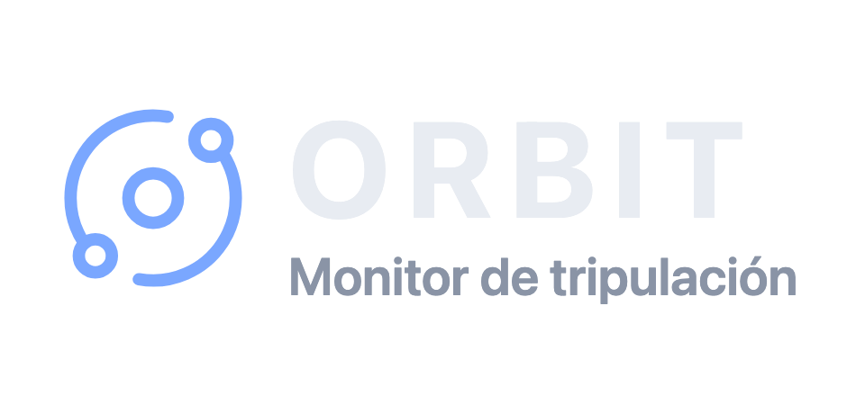
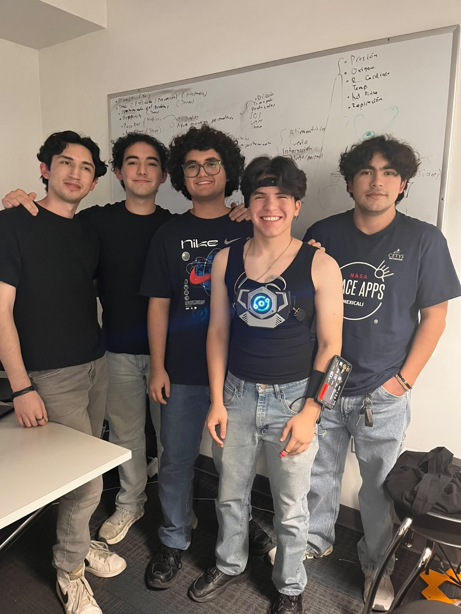
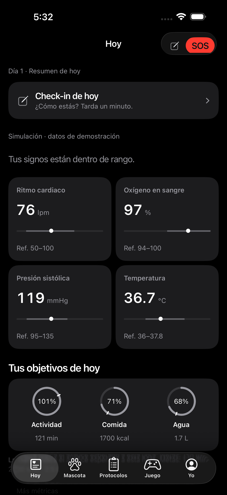
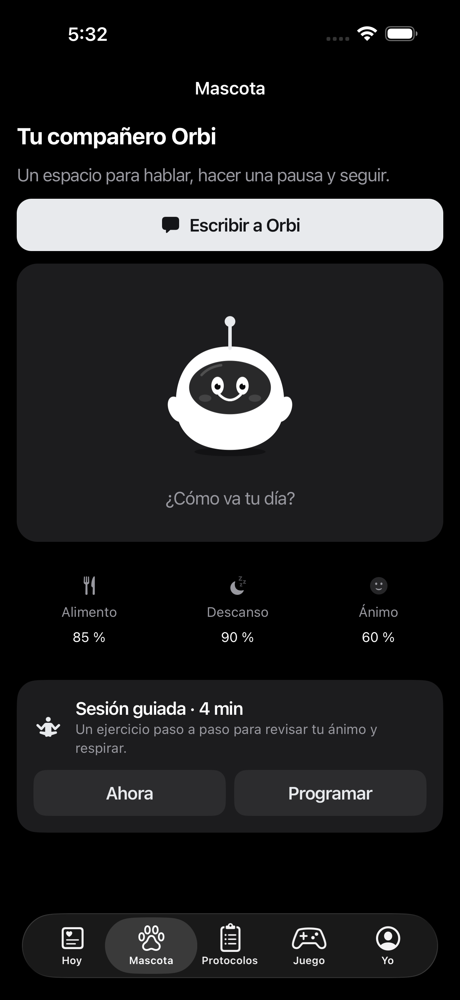
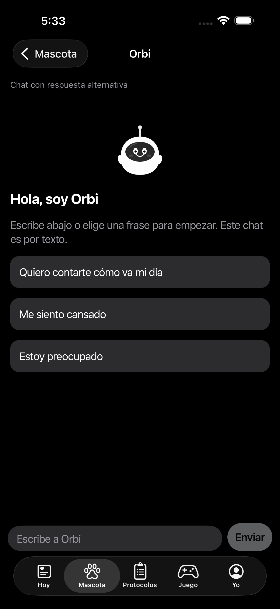

<p align="center"></p>

# ORBIT: Onboard Risk & Behavioral Insight Tracker

**NASA Space Apps Challenge 2026** · Challenge: *Create Health Monitoring Software for Astronauts on Space Missions* · CETYS Universidad, Mexicali

ORBIT is a wearable and software system that lets a crew watch its own physical and behavioral health **with no link to Earth**. Sensor garments stream vitals to each astronaut's wrist phone. The phone sends them over the habitat's local network to a mission computer, which runs the rules, raises emergencies, prescribes protocols and answers the commander through an AI assistant that runs entirely on board.

<p align="center"></p>

## The problem

On Moon and Mars missions the crew faces radiation, isolation, confinement and altered gravity, while messages to Earth take minutes and the crew are not doctors. Health checks still depend mostly on ground teams and scattered data. A slow decline in heart health, sleep, exercise or mood can go unnoticed until it becomes an emergency.

## What we built

| Layer | What it does | Where |
|---|---|---|
| **Wearables** | ESP32 chest vest (ECG, heart rate, IMU, skin temperature, LED status light), wrist band (heart rate, IMU), head band (camera) | [`firmware/`](firmware) |
| **Crew app** | Today view, vitals and trends, daily protocols (physical test, reaction game), SOS with CPR guide, an on-device companion pet ("Orbi") that turns habits into a game, leaderboard and explorations | [`mobile/`](mobile) (Expo, iOS, Android and web) |
| **Mission hub** | Validates every reading, applies thresholds, detects emergencies, logs check-ins and prescribes protocols per astronaut | [`hub/`](hub) (Node, runs on the commander's laptop) |
| **Commander dashboard** | Live crew board, per-astronaut detail, proximity graph, protocols, crew album, and an AI assistant that cites NASA sources and shows its reasoning live | [`dashboard/`](dashboard) (Next.js) |
| **Shared contract** | One set of types, thresholds, messages and texts used by all parts, with self-checks | [`shared/`](shared) |

| Today | Companion pet | Pet chat |
|---|---|---|
|  |  |  |

### How it works

```
 Vest ESP32 ─ Bluetooth Classic (250 Hz ECG + IMU) ─┐
 Band ESP32 ─ BLE ──────────────────────────────────┼─► Crew phone (wrist) ── WebSocket on the habitat LAN ──► Mission hub
 Head ESP32 ─ BLE (camera) ─────────────────────────┘     on-device LLM pet                                  rules · emergencies · RAG · agent
                                                                                                                │
                                                                                     Commander dashboard ◄──────┤
                                                                                     local LLM (llama.cpp) ◄────┘
```

- **No internet needed.** Every model runs on board: a small Qwen3 model on the phone, a larger Qwen model on the mission laptop through llama.cpp.
- **Store and forward.** If the network drops, the phone queues up to 500 messages and sends them when it reconnects.
- **Emergencies both ways.** The astronaut can trigger SOS from the wrist, or the hub raises one from the vitals. The dashboard and every phone show it, and the phone walks the crew through CPR adapted for microgravity.
- **Behavioral health, not just vitals.** Daily check-ins, reaction tests, team interaction (proximity between crew phones) and news from home feed the risk picture, following NASA's Human Research Program behavioral risk.

More detail: [Architecture](docs/ARCHITECTURE.md) · [Conventions](docs/CONVENTIONS.md) · [Design brief](docs/product/DESIGN-BRIEF.md)

## NASA data and resources

The commander's assistant answers from a local knowledge base ([`hub/kb/`](hub/kb)) built from these sources (paraphrased, each file cites its source):

- NASA Human Research Program, *Human Research Program hazards* (isolation and confinement, sleep, distance from Earth): https://www.nasa.gov/hrp/hazards/
- NASA HRP Evidence Report, *Risk of Adverse Cognitive or Behavioral Conditions and Psychiatric Disorders* (2025): https://ntrs.nasa.gov/citations/20250001454
- NASA OCHMO-TB-016, *Behavioral Health and Performance*, Rev B (2023): https://www.nasa.gov/wp-content/uploads/2023/12/ochmo-tb-016-behavioral-health.pdf
- NASA HRP Evidence Report, *Risk of Performance and Behavioral Health Decrements Due to Inadequate Cooperation, Coordination, Communication, and Psychosocial Adaptation within a Team* (2022): https://ntrs.nasa.gov/citations/20220007465
- Picano and Holland, *Behavioral Health and Performance*, NASA CLDP MedOps Workshop (2024): https://ntrs.nasa.gov/citations/20240000994
- Bell et al., *Summary Results from the APEX Standardized Suite*, NASA HRP Investigators' Workshop (2026): https://ntrs.nasa.gov/citations/20260002661 and https://ntrs.nasa.gov/citations/20250011721

Space agency partner and other sources:

- ESA / DGLRM guideline for CPR in microgravity (2020): https://pmc.ncbi.nlm.nih.gov/articles/PMC7607644/
- WHO, *Psychological first aid: Guide for field workers* (2011): https://www.who.int/publications/i/item/9789241548205

## Run it

```bash
npm run db         # local pgvector (Docker); optional, the hub falls back to memory
npm run hub        # mission hub on :8790
npm run sim        # 4 simulated crew members (add -- --emergency c2)
npm run dashboard  # commander dashboard
npm run mobile     # crew app (Expo)
npm run check      # contract self-checks
```

The assistant needs a llama.cpp server on `:8080` (`LLM_URL`). Firmware builds with `arduino-cli` for `esp32:esp32:esp32` (vest) and the XIAO ESP32-C3 (head band).

## Status and limits

- **Working:** live vest ECG and IMU in the app, LED status light that follows the heartbeat and turns red as heart rate rises, crew app on iOS, Android and web, hub, dashboard, on-board assistant with NASA sources, SOS flow, daily protocols.
- **Simulated in the demo:** blood pressure, temperature (when the sensor is missing), water and sleep. These are clearly generated values for demonstration, not readings.
- **Known hardware issue:** our current vest board browns out when its Bluetooth radio starts, so the latest firmware ships with Bluetooth off (`USAR_BT` in `firmware/esp_sensores`) until the power supply is fixed.
- **Not measured by wearables:** glucose, EEG, bone and muscle loss. The hub prescribes a check on the ship's dedicated equipment instead.
- **Thresholds** are generic adult clinical ranges for now (`shared/src/index.ts`); the next step is to align them with NASA-STD-3001.
- **Planned:** ESP-NOW body network with LoRa repeaters across the habitat, a radiation dose sensor, and a 3D crew status view.

## Use of AI

- **In the product:** a small Qwen3 model runs on the phone for the companion pet. A Qwen model served by llama.cpp powers the commander's assistant, which uses retrieval over the NASA knowledge base and tools to read crew data.
- **In development:** the team used an AI coding assistant (Claude Code) to help write and review code across the repository. The idea, the hardware and all design decisions are the team's own. No AI-generated images or NASA branding are used.

## Team

Jorge Humberto Ibarra Flores · Alejandro Pineda Aguirre · Francisco Javier Castillo Osobampo · Erick Blanco Nakashima · Jesse Banda Chaidez

CETYS Universidad, Mexicali, Baja California, Mexico.

## License

[MIT](LICENSE)
